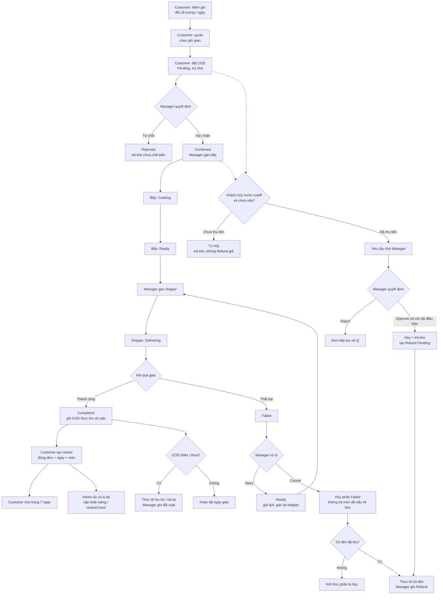

Tôi đã đối chiếu với backend hiện tại. Dưới đây là bộ flow test **theo vai trò và chức năng**, dùng trực tiếp trên Postman, tập trung vào COD.

**Điểm cần phân biệt về đổi lịch:**

| Chức năng | Hiện trạng |
|---|---|
| Đổi ngày giao khi món còn trong giỏ | Có |
| Chọn/đổi giờ trước khi đặt đơn | Có, gửi lại quote với giờ mới |
| Đổi ngày/giờ của đơn đã tạo | **Chưa có API** |
| Manager cho giao lại khi Failed | Có, nhưng **không đổi ngày/giờ đã lưu** |

---

## 1. Chuẩn bị chung

Base URL:

```text
http://localhost:4000
```

Các request JSON sử dụng:

```text
Content-Type: application/json
Authorization: Bearer <token đúng vai trò>
```

Chuẩn bị tài khoản:

| Tài khoản | Mục đích |
|---|---|
| Customer A | Đặt đơn, hủy, đánh giá |
| Customer B | Test truy cập/sửa dữ liệu của người khác |
| Manager | Xác nhận, phân công, duyệt hủy, đối soát |
| Kitchen Staff | Chế biến phần được gán |
| Delivery Staff | Giao phần được gán |
| Admin | Cấu hình cutoff và ẩn đánh giá |

Các biến nên tạo trong Postman:

| Biến | Nguồn |
|---|---|
| `foodId`, `foodId2` | ID hai món đang bán |
| `cartVersion` | Version giỏ mới nhất |
| `lineId` | `_id` dòng giỏ |
| `deliveryDate` | Ngày giao dạng `YYYY-MM-DD` |
| `deliveryTime` | Giờ giao dạng `HH:mm` |
| `orderId` | ID đơn đã tạo |
| `deliveryId` | `_id` trong `deliveries[]` của đơn |
| `orderVersion` | Version đơn mới nhất |
| `kitchenId`, `shipperId` | ID nhân viên |
| `codExpectedAmount` | Số COD phải thu của ngày |
| `reviewId` | ID đánh giá đã tạo |
| `cancellationRequestId` | ID yêu cầu hủy |

**Lưu ý:** `lineId`, `foodId`, `deliveryId` là ba loại ID khác nhau. `cartVersion` và `orderVersion` cũng khác nhau.

### **POST /users/login**

Đăng nhập lần lượt từng tài khoản.

Body:

```json
{
  "identifier": "customer@example.com",
  "password": "Password123"
}
```

Lấy:

```text
result.access_token
result.role
```

### **GET /users/me**

Dùng token của bếp và shipper để lấy ID tương ứng.

Không có body.

```text
result._id → kitchenId hoặc shipperId
```

### Thứ tự các kịch bản

| Kịch bản | Thứ tự |
|---|---|
| A — Giao thành công và đánh giá | Customer đặt → Manager xác nhận/gán bếp → Bếp nấu → Manager gán shipper → Shipper giao → Customer đánh giá → Admin kiểm duyệt |
| B — Khách tự hủy | Tạo đơn mới → khách hủy Pending hoặc Confirmed trước cutoff |
| C — Manager từ chối | Tạo đơn mới → Manager từ chối Pending |
| D — Giao lại | Tạo đơn mới → Delivering → Failed → Manager Retry → gán lại → giao |
| E — Hủy Failed | Tạo đơn mới → Delivering → Failed → Manager Cancel |
| F — Đối soát | Giao thành công nhưng thu thiếu/thừa → Manager ghi thu bù/trả lại |
| G — Gói tuần | Đặt đủ ngày/bữa → xử lý từng ngày → đánh giá ngày Completed |

**Mỗi kịch bản độc lập nên tạo đơn mới.**

---

## 2. Customer — Giỏ hàng, đổi ngày/giờ và đặt đơn

### **GET /foods?limit=20**

Chọn hai món đang bán, đủ kho.

Lưu:

```text
result.foods[i]._id → foodId / foodId2
```

Kiểm tra `availability.inStock` và `availability.isActive`.

### **GET /cart**

Token: **Customer A**.

Lấy:

```text
result.currentCart.version → cartVersion
```

Nên bắt đầu với giỏ rỗng.

### **PATCH /cart/mode**

Chọn mua lẻ.

Body:

```json
{
  "cartType": "FOOD",
  "version": {{cartVersion}}
}
```

**Kiểm tra:** giỏ chuyển sang FOOD. Đổi mode khi giỏ còn món phải bị chặn.

### **POST /cart/items**

Thêm món thứ nhất.

Body:

```json
{
  "itemId": "{{foodId}}",
  "quantity": 1,
  "cartType": "FOOD",
  "deliveryDate": "{{deliveryDate}}",
  "mealSlot": "Lunch",
  "version": {{cartVersion}}
}
```

Lưu:

```text
result.version → cartVersion
result.items[i]._id → lineId
```

Muốn test đánh giá nhiều món trong cùng ngày, gọi thêm một lần với `foodId2`, cùng ngày giao và version mới.

### **PATCH /cart/items/{{lineId}}**

Sửa số lượng.

Body:

```json
{
  "quantity": 2,
  "version": {{cartVersion}}
}
```

**Kiểm tra:**

- Đúng dòng được thay đổi.
- Tổng tiền thay đổi.
- Version tăng.
- Gửi lại version cũ bị chặn.

Có thể sửa về `quantity: 1` trước khi tiếp tục.

### **PATCH /cart/items/{{lineId}}**

Đổi ngày giao **khi còn trong giỏ**.

Body:

```json
{
  "deliveryDate": "2026-10-22",
  "version": {{cartVersion}}
}
```

Thay ngày ví dụ bằng ngày phù hợp khi bạn test.

**Kiểm tra:**

- Dòng giỏ được cập nhật ngày.
- Giỏ FOOD không được chứa nhiều ngày giao.
- Ngày trong quá khứ bị chặn.

Nếu giỏ FOOD có nhiều dòng, việc đổi riêng một dòng sang ngày khác có thể bị chặn vì tạo giỏ nhiều ngày. Test đổi ngày với giỏ một dòng sẽ dễ kiểm tra hơn.

### **DELETE /cart/items/{{lineId}}**

Xóa một dòng giỏ.

Body:

```json
{
  "version": {{cartVersion}}
}
```

Hoặc dùng PATCH với `quantity: 0`.

Đây là bước test riêng; nếu xóa hết món thì thêm lại trước khi đặt hàng.

### **POST /cart/refresh**

Không có body.

**Kiểm tra:**

```text
result.currentCart.canCheckout
result.currentCart.issues
result.currentCart.version
```

Món bị ẩn, hết kho hoặc ngày không hợp lệ phải được báo trong giỏ.

### **POST /orders/quote**

Báo giá và chọn giờ giao.

Body:

```json
{
  "deliveryAddress": "123 Nguyễn Văn Cừ, Quận 5, TP.HCM",
  "deliveryDate": "{{deliveryDate}}",
  "deliveryTime": "{{deliveryTime}}",
  "packageType": "ONE_DAY",
  "cartType": "FOOD",
  "distanceKm": 6,
  "paymentMethod": "COD",
  "note": "Gọi trước khi giao"
}
```

**Test đổi giờ:** gửi quote với `deliveryTime: "12:00"`, rồi gửi lại với `"18:00"`.

Kiểm tra:

```text
result.deliveries[0].scheduledAt
result.deliveries[0].cutoffAt
result.pricing.grandTotal
```

Quote chưa tạo đơn hoặc trừ kho. Ngày trong quote phải khớp ngày các dòng giỏ.

Lấy:

```text
result.cart.version → cartVersion
```

### **POST /orders**

Đặt đơn với ngày/giờ đã chọn.

Body:

```json
{
  "deliveryAddress": "123 Nguyễn Văn Cừ, Quận 5, TP.HCM",
  "deliveryDate": "{{deliveryDate}}",
  "deliveryTime": "{{deliveryTime}}",
  "packageType": "ONE_DAY",
  "cartType": "FOOD",
  "distanceKm": 6,
  "paymentMethod": "COD",
  "note": "Gọi trước khi giao",
  "idempotencyKey": "postman-order-A-001",
  "cartVersion": {{cartVersion}}
}
```

**Kỳ vọng:**

```text
HTTP 201
status = Pending
payment.status = Pending
inventoryHold.status = Committed
```

Lưu:

```text
result.orderId → orderId
result.deliveries[0]._id → deliveryId
result.version → orderVersion
```

**Không lấy `deliveryId` từ quote.**

Kiểm tra thêm:

- Kho đã trừ.
- Giỏ đã rỗng.
- Chưa ghi thu tiền COD.
- Gửi lại đúng body và idempotency key trả cùng đơn, không trừ kho lần hai.
- Đơn mới phải dùng idempotency key mới.

### **GET /orders/{{orderId}}**

Xem trạng thái và lấy version hiện tại.

Customer A xem được đơn của mình. Dùng token Customer B phải bị từ chối/không tìm thấy đơn.

### Về đổi lịch sau khi đặt

Hiện không có API đổi `deliveryDate` hoặc `deliveryTime` cho Order đã tạo.

Không thể dùng PATCH dòng giỏ để sửa lịch của đơn cũ. Nếu còn đủ điều kiện, có thể test **hủy đơn rồi đặt đơn mới**, nhưng đó là hai giao dịch riêng.

---

## 3. Manager — Xác nhận, phân công và xử lý ngoại lệ

### **GET /orders/all**

Token: **Manager**.

Xem danh sách đơn.

### **PATCH /orders/{{orderId}}/decision**

Xác nhận đơn Pending.

Body:

```json
{
  "status": "Confirmed",
  "version": {{orderVersion}},
  "reason": "Đủ nguyên liệu phục vụ"
}
```

**Kỳ vọng:** đơn/ngày chuyển Confirmed; COD vẫn chưa được coi là đã thu tiền.

Lấy version mới.

### **PATCH /orders/{{orderId}}/deliveries/{{deliveryId}}/kitchen-assignment**

Gán nhân viên bếp.

Body:

```json
{
  "kitchenStaffIds": ["{{kitchenId}}"],
  "version": {{orderVersion}},
  "reason": "Phân công chuẩn bị món"
}
```

**Kiểm tra:**

- Nhân viên phải Active và đúng vai trò bếp.
- Không gán tài khoản Customer hoặc shipper vào bếp.
- Không có cơ chế chia ca.

### **PATCH /orders/{{orderId}}/deliveries/{{deliveryId}}/shipper-assignment**

Thực hiện **sau khi bếp báo Ready**.

Body:

```json
{
  "assignedShipperId": "{{shipperId}}",
  "version": {{orderVersion}},
  "reason": "Phân công giao hàng"
}
```

**Kiểm tra:** chỉ gán shipper khi ngày giao Ready.

### **PATCH /orders/{{orderId}}/decision**

Nhánh từ chối: dùng **đơn mới còn Pending**.

Body:

```json
{
  "status": "Rejected",
  "version": {{orderVersion}},
  "reason": "Bếp quá tải"
}
```

**Kỳ vọng với COD chưa thu:**

- Đơn Rejected.
- Kho chưa chế biến được trả.
- Không tạo hoàn tiền giả.
- Không thể tiếp tục đưa đơn vào Cooking.

---

## 4. Kitchen Staff — Chế biến

### **GET /workspace/orders**

Token: **bếp được gán**.

**Kiểm tra:**

- Chỉ thấy phần việc của mình.
- Không có các trường tiền COD dành cho Manager/shipper.
- Bếp khác không được thao tác phần chưa được phân công.

### **PATCH /orders/{{orderId}}/deliveries/{{deliveryId}}/kitchen-status**

Bắt đầu nấu.

Body:

```json
{
  "status": "Cooking",
  "version": {{orderVersion}}
}
```

**Kỳ vọng:** Confirmed → Cooking.

Từ thời điểm này khách không được hủy thông thường.

### **PATCH /orders/{{orderId}}/deliveries/{{deliveryId}}/kitchen-status**

Nấu xong.

Body:

```json
{
  "status": "Ready",
  "version": {{orderVersion}}
}
```

**Test lỗi:**

| Thao tác | Kỳ vọng |
|---|---|
| Confirmed → Ready trực tiếp | Bị chặn |
| Bếp chưa được gán thao tác | Bị chặn |
| Bếp tự chuyển Delivering/Completed | Bị chặn |
| Nấu ngày giao tương lai | Bị chặn |
| Dùng version cũ | 409 |

Sau Ready, quay lại Manager để gán shipper.

---

## 5. Delivery Staff — Giao hàng và COD

### **GET /workspace/orders**

Token: **shipper được gán**.

Tìm đúng `orderId` và `deliveryId`.

Lấy:

```text
version → orderVersion
codExpectedAmount → codExpectedAmount
```

### **PATCH /orders/{{orderId}}/deliveries/{{deliveryId}}/shipper-status**

Nhận hàng và xuất phát.

Body:

```json
{
  "status": "Delivering",
  "version": {{orderVersion}}
}
```

**Kỳ vọng:** Ready → Delivering.

### **PATCH /orders/{{orderId}}/deliveries/{{deliveryId}}/shipper-status**

Giao thành công, thu đúng số phải thu.

Body:

```json
{
  "status": "Completed",
  "version": {{orderVersion}},
  "codCollectedAmount": {{codExpectedAmount}}
}
```

**Kiểm tra:**

- Ngày giao Completed.
- Lưu số thực thu.
- Chênh lệch bằng 0.
- Ghi calo cho ngày đã giao.
- Customer được đánh giá món của ngày này.
- Gửi lại đúng request cũ không thu/cộng calo hai lần.

### **PATCH /orders/{{orderId}}/deliveries/{{deliveryId}}/shipper-status**

Nhánh Failed: dùng đơn khác đang Delivering.

Body:

```json
{
  "status": "Failed",
  "version": {{orderVersion}},
  "reason": "Không liên hệ được với khách",
  "evidenceUrls": []
}
```

**Kiểm tra:**

- Lý do bắt buộc, ảnh không bắt buộc.
- Lưu `failedAt`.
- Không ghi thu COD, không cộng calo.
- Không trả món đã nấu về kho.
- Shipper không tự chuyển Failed → Delivering.

---

## 6. Customer — Đánh giá sau khi nhận hàng

Thực hiện sau khi ngày giao của kịch bản A đã `Completed`.

### **POST /reviews**

Token: **Customer A — chủ đơn**.

Body:

```json
{
  "orderId": "{{orderId}}",
  "deliveryId": "{{deliveryId}}",
  "foodId": "{{foodId}}",
  "rating": 5,
  "comment": "Món ngon, giao đúng hẹn",
  "images": []
}
```

**Kỳ vọng:**

```text
HTTP 201
result.verifiedPurchase = true
result.isHidden = false
```

Lưu:

```text
result._id → reviewId
```

`foodId` phải thuộc chính ngày `deliveryId` đã Completed.

### **GET /reviews/Food/{{foodId}}?page=1&limit=20**

API công khai, không cần token.

Kiểm tra đánh giá vừa tạo xuất hiện trong `result`, là một mảng.

### **PATCH /reviews/{{reviewId}}**

Token: **tác giả đánh giá**.

Body:

```json
{
  "rating": 4,
  "comment": "Món ngon nhưng khẩu phần hơi ít",
  "images": []
}
```

**Kỳ vọng:** sửa thành công trong **7 × 24 giờ từ lúc tạo**.

Gọi lại GET danh sách để kiểm tra, vì response sửa chủ yếu trả thông báo.

Không gửi `orderId`, `deliveryId`, `foodId`, `reviewerId` hoặc `version` vào body sửa review.

### **GET /reviews/Food/{{foodId}}?rating=4&hasImages=false&page=1&limit=20**

Kiểm tra lọc đúng số sao và đánh giá không có ảnh.

Muốn lọc đánh giá có ảnh:

```text
GET /reviews/Food/{{foodId}}?hasImages=true&page=1&limit=20
```

### **GET /foods/{{foodId}}**

Kiểm tra:

```text
result.rating
result.reviewCount
```

Điểm phải tính từ các review đang hiển thị. Nếu món chỉ có một review vừa sửa thành 4 sao, kỳ vọng `rating = 4`, `reviewCount = 1`.

### **POST /medias/upload-image**

Token: **Customer**, nếu muốn test ảnh đánh giá.

Body chọn **form-data**:

| Key | Type | Value |
|---|---|---|
| `image` | File | Chọn ảnh |

Không tự đặt header JSON cho request này.

Lấy URL tại `result[0]`, đưa vào `images` khi tạo/sửa review. Không gửi khóa Cloudinary.

### Các trường hợp đánh giá phải test

| Trường hợp | Kỳ vọng |
|---|---|
| Đánh giá trước Completed | 403 |
| Customer B đánh giá đơn của A | 403 |
| Món không thuộc ngày giao đã chọn | 403 |
| Gửi lại cùng đơn + ngày + món | 409 |
| Hai món khác nhau trong một ngày Completed | Tạo được hai review |
| Cùng món ở hai ngày Completed | Mỗi ngày được một review |
| Cùng món lặp ở nhiều bữa của cùng ngày | Chỉ một review |
| Rating ngoài 1–5 | Bị chặn |
| Comment rỗng hoặc vượt 5.000 ký tự | Bị chặn |
| Ảnh HTTP hoặc quá 10 ảnh | Bị chặn |
| Customer B sửa review của A | 403 |
| Sửa đủ/sau 7 ngày | 409 |
| Gửi thêm `foodId` để đổi món khi sửa | 400 |

Với gói tuần, **không cần chờ cả gói Completed** mới đánh giá ngày đã giao.

Nếu DB cũ còn unique index chỉ trên `orderId`, review món/ngày thứ hai có thể bị chặn sai. Khi gặp tình huống này cần kiểm tra migration review trước, không kết luận lỗi ở body Postman.

---

## 7. Admin — Kiểm duyệt đánh giá và cấu hình

### **PATCH /reviews/{{reviewId}}/hide**

Token: **Admin**.

Body:

```json
{
  "reason": "Nội dung đánh giá vi phạm quy định"
}
```

**Kỳ vọng:**

```text
changed = true
```

Sau đó kiểm tra:

- GET review công khai không còn trả review đó.
- `Food.rating` và `Food.reviewCount` được tính lại.
- Có audit và thông báo cho tác giả.
- Bản ghi được ẩn, không bị xóa.

Gửi lại request ẩn:

```text
changed = false
```

Không tạo thêm thông báo/audit cho cùng lần ẩn.

### Các trường hợp cần thử

| Thao tác | Kỳ vọng |
|---|---|
| Manager/bếp/shipper/Customer gọi hide | 403 |
| Admin ẩn không có lý do | Bị chặn |
| Tác giả sửa review đã ẩn trong hạn | Được sửa, nhưng vẫn ẩn |
| Tạo review mới thay review đã ẩn cùng đơn/ngày/món | 409 |
| Customer gọi DELETE review của mình | 403 |

`DELETE /reviews/{{reviewId}}` với token Admin và body lý do cũng là **ẩn**, không phải xóa vật lý.

### **GET /admin/commerce-settings**

Đọc và lưu cấu hình cutoff hiện tại.

### **PATCH /admin/commerce-settings**

Nếu muốn test giao ngay trong ngày, trên **DB test riêng**, trước 23:00:

```json
{
  "kitchenCutoffTime": "23:00",
  "kitchenCutoffDaysBefore": 0
}
```

Sau đó tạo đơn mới với:

```text
deliveryDate = ngày hôm nay theo giờ Việt Nam
deliveryTime = 23:30
```

Cách này cho phép test đặt, hủy trước cutoff, bếp và giao trong cùng ngày. Khi xong, trả cấu hình về giá trị đã lưu.

Với cấu hình mặc định, phải đặt trước cutoff hôm trước và chờ tới ngày giao để test bếp/shipper.

---

## 8. Customer + Manager — Hủy đơn và duyệt hủy

### **GET /orders/{{orderId}}/cancellation**

Token: **Customer**.

Xem trước hủy toàn đơn/các ngày còn lại.

Kiểm tra:

```text
result.requiresApproval
result.lines[].creditedAmount
result.lines[].refundAmount
result.version
```

### **POST /orders/{{orderId}}/cancellation-requests**

Token: **Customer**.

Hủy toàn đơn:

```json
{
  "version": {{orderVersion}},
  "reason": "Tôi thay đổi kế hoạch nhận hàng"
}
```

Hủy một ngày trong gói tuần:

```json
{
  "deliveryId": "{{deliveryId}}",
  "version": {{orderVersion}},
  "reason": "Tôi không nhận ngày này"
}
```

**Phần chưa thu COD:**

```text
request.status = Approved
request.automatic = true
```

Ngày bị hủy chuyển Cancelled, trả kho chưa chế biến, không tạo Refund giả.

**Phần đã thu tiền hợp lệ:**

```text
request.status = Pending
request.automatic = false
```

Chưa hủy đơn, chưa trả kho; chờ Manager.

Lưu `result.request._id` thành `cancellationRequestId`.

### **GET /workspace/cancellation-requests?page=1&limit=20**

Token: **Manager**.

Xem yêu cầu đang chờ.

### **PATCH /orders/{{orderId}}/cancellation-requests/{{cancellationRequestId}}**

Token: **Manager**.

Duyệt:

```json
{
  "action": "Approve",
  "version": {{orderVersion}},
  "reason": "Đủ điều kiện hủy trước cutoff và chưa nấu"
}
```

Từ chối:

```json
{
  "action": "Reject",
  "version": {{orderVersion}},
  "reason": "Phần giao đã bắt đầu chế biến"
}
```

**Kiểm tra:**

- Khi duyệt phải kiểm tra lại cutoff và trạng thái bếp.
- Duyệt hợp lệ trả kho và tạo yêu cầu hoàn cho khoản thực thu.
- Từ chối không tự đổi kho/tiền/trạng thái đơn.
- Không duyệt hai lần.
- Không cho Customer tự hủy sau Cooking hoặc sau cutoff.
- Hủy ngày đầu gói tuần miễn/hoàn phí ship ngày đó, không chuyển sang ngày khác.

**Giới hạn dữ liệu test:** luồng COD công khai thu tiền khi Completed, nên nhánh “đã thu nhưng còn Pending/Confirmed” cần fixture riêng có sổ thu tiền đúng ngày. Không thể tạo nhánh này chỉ bằng cách gửi `payment.status = Paid`.

---

## 9. Manager — Failed, giao lại và đối soát

### **GET /workspace/cod-issues?kind=All&page=1&limit=20**

Token: **Manager**.

Xem ngày Failed hoặc còn chênh lệch COD.

### **PATCH /orders/{{orderId}}/deliveries/{{deliveryId}}/failure-resolution**

Giao lại:

```json
{
  "action": "Retry",
  "version": {{orderVersion}},
  "reason": "Đã liên hệ được với khách"
}
```

Kỳ vọng:

```text
Failed → Ready
Bỏ phân công shipper hiện hành
Giữ lịch sử Failed
```

Manager phải gán lại shipper, rồi shipper chuyển Delivering. **Thao tác này không đổi lịch giao đã lưu.**

Hoặc hủy:

```json
{
  "action": "Cancel",
  "version": {{orderVersion}},
  "reason": "Không thể giao lại"
}
```

Kỳ vọng:

- Cancelled riêng phần Failed.
- Giảm tiền món và ship của ngày.
- Không trả món đã nấu về kho.
- Chưa thu thì không có Refund.
- Failed chưa xử lý đủ 24 giờ được job tự hủy.

### **GET /orders/{{orderId}}/deliveries/{{deliveryId}}/cod-reconciliation**

Đọc sổ tiền của ngày giao.

Ví dụ phải thu 70.000đ:

| Shipper đã khai | `balance` | Cần làm |
|---|---:|---|
| 60.000đ | 10.000 | Thu bù |
| 70.000đ | 0 | Không đối soát thêm |
| 80.000đ | -10.000 | Trả lại tiền thừa |

Để test thiếu/thừa, ở bước Completed hãy gửi `codCollectedAmount` tương ứng.

### **POST /orders/{{orderId}}/deliveries/{{deliveryId}}/cod-reconciliation**

Sau khi thực tế thu bù:

```json
{
  "action": "Collect",
  "version": {{orderVersion}},
  "amount": 10000,
  "reference": "TEST-THU-BU-001",
  "reason": "Đã nhận thêm 10.000đ từ khách"
}
```

Sau khi thực tế trả lại:

```json
{
  "action": "Refund",
  "version": {{orderVersion}},
  "amount": 10000,
  "reference": "TEST-HOAN-001",
  "reason": "Đã trả lại 10.000đ cho khách"
}
```

**Kiểm tra:**

- Không vượt số còn thiếu/thừa.
- Có thể ghi từng phần.
- Không dùng lại mã tham chiếu trên cùng đơn.
- Không sửa số shipper đã khai.
- Không xóa nợ.
- Refund Pending chưa làm tăng số thực hoàn; ghi Refund thực tế mới tăng.
- Khi xử lý hết, `balance = 0`.

---

## 10. Sơ đồ thứ tự test theo vai trò



Trong lượt này tôi chỉ đọc code để lập flow; **chưa gửi request vào DB của bạn và không sửa nội dung nào**.